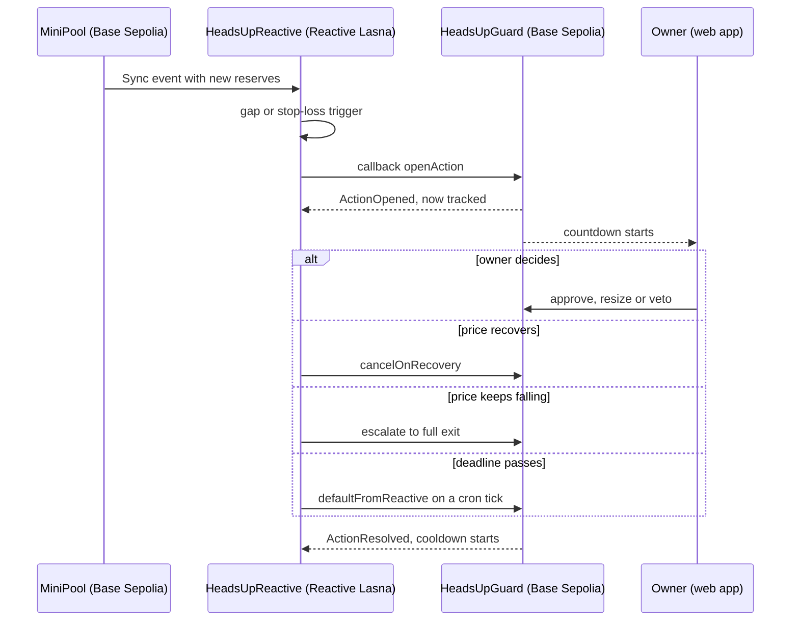

# Veto

A liquidity position that tells you before it acts. A reactive contract watches a pool, and when risk appears it opens a countdown for you to approve, resize or veto. It keeps watching while you decide, cancels if the price recovers, escalates if it keeps falling, and sells a safe share on its own if you never answer.

## The problem

DeFi automation is all or nothing. A bot acts without asking you, or an alert arrives after the moment has passed. Veto puts a human decision inside the loop without making the loop slow, because the whole path from a pool event to a pending decision takes one to two seconds.

## What it does

1. **Detect.** `HeadsUpReactive` runs on Reactive Omni and subscribes to the pool's `Sync` events on Base Sepolia. It fires on a price gap (a drop of at least 5 percent between observations) or when the price nears a stop-loss level.
2. **Open a countdown.** It requests a callback and `HeadsUpGuard` on Base Sepolia opens a pending action with a 60 second window. The web app shows a live ring.
3. **Decide.** The position owner can approve the proposed 50 percent reduction, resize it anywhere from 1 to 100 percent, or veto.
4. **Keep working during the window.** The reactive contract tracks the guard's events. If the price recovers by 3 percent it cancels the action. If the price falls a further 5 percent it escalates to a full exit with a shorter deadline.
5. **Default safely.** If nobody decides, the reactive contract uses network cron ticks to request the default as soon as the deadline passes. The guard also exposes a permissionless `executeDefault()` as a last resort.

Every step is a real transaction. The loop was run on the live networks nine times across approve, veto, timeout and recover.

## Measured on the live testnets

Pool swap on Base Sepolia to the guard opening the action, measured over 9 actions:

| Measure | Result |
| --- | --- |
| Swap block to action opened (block timestamps) | min 1s, mean 1.4s, max 2s |
| Same, estimated from Base block counts at 200ms per block | min 0.8s, mean 1.4s, max 1.8s |
| Decision window left for the user | 58 to 59 of 60 seconds |
| Deadline to default executed (10 second cron tick) | 3 to 9 seconds |
| lREACT spent per scenario | about 0.045 to 0.07, timeout about 0.13 to 0.15 |

The full table with every transaction hash is generated by `npm run report` and saved in `backend/data/submission.md`. The reactive chain and the origin chain stamp blocks with different clocks, so the reactive hop can read one second early. The report shows it as 0s and says so. End to end is measured on Base Sepolia alone and is not affected. We did not run on the previous network, so we make no measured comparison with it.

One complete loop, a timeout (action 1):

| Step | Chain | Transaction |
| --- | --- | --- |
| Pool swap that forced a gap | Base Sepolia | [`0x8976b699c61cba18d7e98846c3137628c939198ede9654bea14972225251ddc8`](https://sepolia.basescan.org/tx/0x8976b699c61cba18d7e98846c3137628c939198ede9654bea14972225251ddc8) |
| Reactive transaction that detected it | Reactive Lasna | `0xcb68d6694219ad15966b70bca1fe1559adc2635f7da32eeb96759ed2ef7128c8` |
| Callback that opened the action | Base Sepolia | [`0x295e5af103a9f19cb39e941dc23e2bfe34b074b9f08f670eea0cfa5ed846d9fb`](https://sepolia.basescan.org/tx/0x295e5af103a9f19cb39e941dc23e2bfe34b074b9f08f670eea0cfa5ed846d9fb) |
| Reactive transaction that requested the default | Reactive Lasna | `0xa898801f1365e100317a37906d78d607472d88ee7b5528f65f28bf9495580531` |

Swap to action opened: 1 second (6 Base blocks). Deadline to resolved: 4 seconds.

## Architecture



More detail, including the state machine and trust model, is in [docs/ARCHITECTURE.md](docs/ARCHITECTURE.md).

## Deployed contracts

| Contract | Chain | Address |
| --- | --- | --- |
| HeadsUpReactive | Reactive Lasna (5318007) | `0xEF650672437A97A7b987984239064D502F56272d` |
| HeadsUpGuard | Base Sepolia (84532) | `0x5b3aA1be08C5E5E69c888eEb1E7a906475f062E6` |
| PositionVault (fixture) | Base Sepolia | `0x82cad1A1A22Cce5A4e656c74723C9f0828EE9c0b` |
| MiniPool (fixture) | Base Sepolia | `0xE8c5F6374Bb561449b0136B348EC8BBD08414701` |
| Risk token (fixture) | Base Sepolia | `0x539BfA02D110Eb82AC483bc9A1e0C35548c50CD5` |
| Stable token (fixture) | Base Sepolia | `0x66495006290Dc21b13DEDa2401A3076F2592f51f` |

The same addresses are in `contracts/deployments/*.json`.

## Test fixtures

The pool, both tokens and the vault are **test fixtures that we deployed**, and the swap bot is a script that moves their price. Real Base Sepolia pools are too thin to produce a trigger on demand, so a controlled pool is what makes the demo repeatable. The pool emits Uniswap V2 compatible `Sync` and `Swap` events, so the reactive contract also works against a real V2 pair. Everything else (the reactive contract, the guard, the callbacks and the cron timeout) runs for real on the live networks.

## Repository

| Path | What it holds |
| --- | --- |
| `contracts/` | Solidity with Foundry: reactive contract, guard, fixtures, 97 tests, deploy scripts |
| `backend/` | TypeScript: swap bot, demo runner, latency tracer, notifier, offline network simulator, 47 tests |
| `client/` | Vite, React and TypeScript web app with the countdown and decision controls |
| `docs/` | Architecture and the demo script |

## Run it

Requires Node 20 or newer and [Foundry](https://book.getfoundry.sh/getting-started/installation).

```
cd contracts && cp .env.example .env && ./setup.sh && forge test
cd ../backend && npm install && npm test
npm run rehearse
```

`npm run rehearse` runs all four scenarios on two local chains with a simulated reactive network and costs nothing. To deploy, fund your wallet with Base Sepolia ETH and Lasna lREACT, fill in `contracts/.env`, and run `bash contracts/scripts/deploy-all.sh`. Then:

```
cd backend && npm run demo
npm run report
cd ../client && npm install && npm run dev
```

The Lasna faucet is a contract on Base Sepolia: send it ETH and it credits lREACT to the same address (1 ETH gives 100 lREACT).

## Design decisions

- **Cron only while pending.** Ticks are billed whether or not the contract acts, so it subscribes to them when an action opens and unsubscribes when it resolves.
- **Stop-loss hysteresis.** The stop-loss trigger fires once per breach and re-arms only after the price recovers 3 percent above the trigger level. Without it, every pool event after each cooldown would open a new action and each default would keep halving the position. Found during live testing.
- **One pending action at a time, with a cooldown.** The guard ignores duplicate opens and the reactive contract waits 120 seconds after each resolution.
- **Quiet no-ops.** Callbacks are billed even when they revert, so late or duplicate directives return quietly.
- **Immutable trust.** The guard trusts exactly one reactive contract and the vault trusts exactly one guard, both fixed at deploy time.

## Known limits

- The timeout fires on a 10 second tick, so the default lands 3 to 9 seconds after the deadline in our runs. A 1 second tick is supported but costs about ten times more per pending window.
- The first pool event after deployment only records the starting price.
- A reactive contract that runs out of lREACT stops receiving events, and a contract in debt receives nothing. The tooling checks both before running a scenario.
- The position is a single vault holding the risk token. This is a working demonstration of the loop, not an audited product.

## License

MIT
